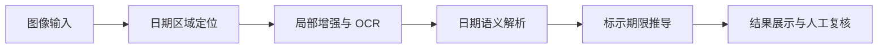

# 轻眸识刻

> 面向消费者、商超和仓储场景的食品包装日期智能识别原型系统
>
> **工程状态**：M0 单图闭环待实现 · Web 优先 · 移动端与微信端暂缓

轻眸识刻聚焦食品包装上微小、模糊、反光或位置不固定的生产日期与保质期信息，尝试通过计算机视觉和日期语义解析，帮助用户更清晰地查看包装标示并完成期限判断。

## 解决的问题

食品包装日期常见于瓶盖、瓶底、封口、袋身边缘或标签角落，容易受到以下因素影响：

- 日期区域面积小，容易被整图文字和包装图案干扰；
- 点阵喷码可能存在断笔、粘连和低对比度；
- 金属、塑料等曲面容易产生反光、褶皱或透视变形；
- 生产日期、有效期、保质期和批号需要进一步区分；
- 信息不完整或识别置信度不足时，需要明确提示人工复核。

典型应用场景包括消费者购买前查验、家庭食品整理，以及商超和仓储场景中的日期巡检。

---

## 核心技术闭环

项目围绕“找得到、读得准、判得清、能改进”展开：

- **找得到**：面向小目标日期区域进行定位检测，减少整图文字干扰；
- **读得准**：对局部日期进行 OCR，按对照结果选择增强或受限字表，研究点阵喷码等场景的识别与误纠正；
- **判得清**：聚合生产日期、到期日和保质期等证据，解析日期语义并输出结构化标示状态；
- **能改进**：规划人工纠偏和独立审核的难例回流，为后续模型与规则迭代提供数据基础。

当前研究候选是“非受控实拍包装日期的证据驱动自适应识读与选择性复核”：先判断结果是否足够可靠，再比较重试或补拍的收益与成本。定位、OCR 和日期解析是已有技术路线，项目贡献须由同条件强基线、未见包装测试和实际结果支持；相关方法仍待实现与验证。

系统规划的处理链路如下：

---

## 项目文档

完整的需求、架构、算法方案和跨仓契约集中维护在 [`ProjectPRD`](https://github.com/QingMouFoodDate/ProjectPRD)，文档能否打开以仓库实际访问权限为准：

- [项目需求](https://github.com/QingMouFoodDate/ProjectPRD/blob/main/需求规格.md)
- [系统架构](https://github.com/QingMouFoodDate/ProjectPRD/blob/main/系统架构.md)
- [算法研究方案](https://github.com/QingMouFoodDate/ProjectPRD/blob/main/算法实验.md)
- [研究现状](https://github.com/QingMouFoodDate/ProjectPRD/blob/main/references/研究现状.md)
- [推进路线](https://github.com/QingMouFoodDate/ProjectPRD/blob/main/开发路线.md)
- [数据模型与接口契约](https://github.com/QingMouFoodDate/ProjectPRD/tree/main/contracts)
- [数据质量规范](https://github.com/QingMouFoodDate/ProjectPRD/blob/main/standards/数据质量规范.md)

---

## 八仓库职责导航

项目按职责划分为以下七个工程仓库，另由 `.github` 维护组织全局配置与主页展示：

| 仓库                                                                | 模块定位       | 主要职责                                 |
| :------------------------------------------------------------------ | :------------- | :--------------------------------------- |
| [`ProjectPRD`](https://github.com/QingMouFoodDate/ProjectPRD)       | 设计与文档中枢 | 需求、架构、算法方案、接口和质量规范     |
| [`TrainPlatform`](https://github.com/QingMouFoodDate/TrainPlatform) | 集成调度训练平台 | 样本资产、数据集版本与切分、标注作业、训练任务调度和模型仓库 |
| [`ModelTrain`](https://github.com/QingMouFoodDate/ModelTrain)       | 算法研发与评测 | 小目标检测、工业 OCR、消融实验和模型导出 |
| [`InferPlatform`](https://github.com/QingMouFoodDate/InferPlatform) | 推理平台       | 识别会话、证据聚合与标示状态决策，内置 Runtime 执行模型加载和前向推理 |
| [`WebClient`](https://github.com/QingMouFoodDate/WebClient)         | Web 原型系统   | 优先实现单图识别与双重视图，多图会话和人工纠偏按 C0 推进 |
| [`MobileClient`](https://github.com/QingMouFoodDate/MobileClient)   | 移动端客户端   | 实拍辅助、离线台账和端侧推理探索         |
| [`WxClient`](https://github.com/QingMouFoodDate/WxClient)           | 微信小程序端   | 轻量查验、大字模式和结果分享             |
| [`.github`](https://github.com/QingMouFoodDate/.github)               | 组织主页配置   | 项目介绍、仓库导航与公开展示维护         |

---

## 数据与安全边界

项目坚持真实数据、契约先行和渐进式工程原则：

1. 样本以真实食品包装实拍为基础，禁止伪造标签、红圈涂鸦和营销字幕污染；
2. 各端通过统一的 [API 契约](https://github.com/QingMouFoodDate/ProjectPRD/blob/main/contracts/API.md)、[数据模型](https://github.com/QingMouFoodDate/ProjectPRD/blob/main/contracts/DATA.md) 和 [模型规约](https://github.com/QingMouFoodDate/ProjectPRD/blob/main/contracts/MODEL.md) 协作；
3. 系统输出的是食品包装上的**标示状态**，不替代食品安全检测；
4. 对信息缺失、证据冲突或识别置信度不足的情况，分别展示期限状态与复核状态，优先提示补拍或人工核对；信息缺失不等于超期，技术故障单独提示；
5. 项目先实现 Web 单图 M0 闭环，再按 C0 推进多图与人工纠偏；移动端和微信端暂缓，端侧推理待独立评审；
6. 离线主基准受控数据集（MasterBenchmark）实行 **1617 张真实原图**规范管理（100% SHA-256 唯一，含 150 张亲审稀缺长尾难例），严格遵循 **8:1:1 科学分层防泄漏切分**（Train 1293 / Val 162 / Test 162），与在线会话数据保持严格物理隔离。

可靠直接到期日可独立比较期限，临期阈值属于项目可配置策略。起算依据不明时提示复核，不凭默认口径补日期，也不将直接与派生值差一天或同日生产到期直接判为标示错误；已确认的真实冲突仍保留。
