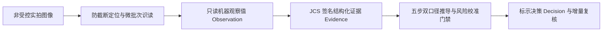

# 轻眸识刻

> 非受控场景下证据驱动的食品包装日期退化微字符识读与风险校准决策系统
>
> 面向真实食品流通与日常消费场景的退化微字符定位识别、双口径期效语义推导与有界风险校准决策系统。
>
> **工程状态**：数据与规则门禁 100% 封板 · 云端网关就绪 · M0 单图视觉闭环冲刺中 · 移动端与微信端暂缓

**轻眸识刻（QingMouFoodDate）** 聚焦食品包装上微小、模糊、反光及位置任意的生产日期、保质期到期日与保质期时长信息，围绕 **“误差可解释、数据可信赖、决策有保证”** 的可信 AI 三大支柱，通过小目标防截断感知、退化微字符自适应识读、符合 GB 7718 新旧国标过渡期规范的五步期效推导以及具有有限样本统计保证的风险校准决策门禁，辅助消费者（尤其是中老年视弱与视障群体）及商超仓储巡检人员可靠核验包装标示期限。

---

## 核心挑战与三大攻关缝隙

包装日期是核对标示期限的依据，不等同于食品安全理化检测。但在真实非受控实拍场景中，日期常以 `<2%` 面积占比的微小字号或低对比度点阵喷码、激光灼刻、钢印压纹印制在瓶盖、罐底、封口或折角处。针对传统“定位—OCR—正则过滤”流水线普遍存在的隐性失效，本项目重点攻关三大核心缝隙：

- **缝隙一（误差可解释）：端到端级联误差接力放大治理**：传统检测框即使 IoU 达标仍可能漏包首尾数字（Cropping Truncation），叠加退化字符误识与启发式规则强行吸附，极易输出“格式合法但完全错误”的日期。系统设立**字符零截断率**指标，结合四级 Oracle 上界归因、分位数边界自适应外扩与运行时微批次多算子竞争自愈（`Tier-1`），从源头阻断误差传递；
- **缝隙二（数据可信赖）：同源商品簇四重防泄漏切分**：摒弃剔除模糊难例或按单图随机切分导致的泛化虚高，构建 **1,613 张真实原图主基准库（1,540 个独立商品连通分量）** 与 **597 对多边形精标集**，强制执行 `group_key`、文本转录、三元组与 64-bit DCT `pHash` 四重跨集合零泄漏切分；
- **缝隙三（决策有保证）：中式双口径安全包络与选择性风险校准门禁**：针对我国 **GB 7718—2011 向 GB 7718—2025 过渡期**“单标 MFG+时长、双标 MFG+EXP、豁免仅标 EXP”三态并存及“生产当日/次日”双口径起算规则，构建五步 `date-rules` 期效推导状态机（36 项标准向量与 12 项高危反例 100% 通过），并引入区分**边际误接受率（mFAR）**与**条件选择性风险（CSR）**的共形风险校准门禁，低置信或冲突时主动触发定向补拍与双轨增量人工复核（`Tier-2`），严守“零超期误报”底线。

---

## 技术闭环

系统严格遵循 `Observation -> Evidence -> Decision` 单向不可变证据演化管线：

- **区域定位与防截断外扩**：构建微小日期区域检测模型，结合验证集残差分位数自适应外扩抑制复杂背景干扰与首尾字符截断；
- **退化字符自适应识读**：针对点阵断笔、激光刻印与曲面反光，通过共享算子库 `qingmou_cv_ops.py` 执行几何拉平、保宽高比填充与微批次增强择优；
- **证据聚合与五步期效推导**：抽取生产日期、到期日与保质期事实并计算 RFC 8785 JCS SHA-256 证据签名，按当日/次日双口径安全包络完成期效状态推导；
- **风险校准门禁与增量复核**：基于校准集标定拒识阈值，区分可靠自动决策与疑难样本，支持字段级/起算模式双轨增量纠偏与闭环回流审核。



---

## 项目文档

核心设计、架构与跨仓契约集中维护于 [`ProjectPRD`](https://github.com/QingMouFoodDate/ProjectPRD) 仓库：

- [需求规格](https://github.com/QingMouFoodDate/ProjectPRD/blob/main/需求规格.md)
- [系统架构](https://github.com/QingMouFoodDate/ProjectPRD/blob/main/系统架构.md)
- [算法实验体系](https://github.com/QingMouFoodDate/ProjectPRD/blob/main/experiments/README.md)
- [研究现状](https://github.com/QingMouFoodDate/ProjectPRD/blob/main/研究现状.md)
- [推进路线](https://github.com/QingMouFoodDate/ProjectPRD/blob/main/开发路线.md)
- [开发任务分解与责任矩阵](https://github.com/QingMouFoodDate/ProjectPRD/blob/main/开发任务分解与责任矩阵.md)
- [数据模型与接口契约](https://github.com/QingMouFoodDate/ProjectPRD/tree/main/contracts)
- [数据质量规范](https://github.com/QingMouFoodDate/ProjectPRD/blob/main/standards/数据质量规范.md)

---

## 仓库导航

项目包含八个系统仓（含文档仓和 `.github`）及独立受控数据仓 `data`：

| 仓库                                                                | 模块定位           | 主要职责                                                                      |
| :------------------------------------------------------------------ | :----------------- | :---------------------------------------------------------------------------- |
| [`ProjectPRD`](https://github.com/QingMouFoodDate/ProjectPRD)       | 需求与契约规范     | 需求规格、系统架构、H1~H8 算法方案、OpenAPI/Schema 契约和质量规范（SSOT）     |
| [`TrainPlatform`](https://github.com/QingMouFoodDate/TrainPlatform) | 集成调度训练平台   | 样本资产准入、数据集版本冻结、标注作业治理、训练任务调度和模型发布门禁        |
| [`ModelTrain`](https://github.com/QingMouFoodDate/ModelTrain)       | 算法研发与评测     | 小目标防截断检测、退化微字符 OCR、风险校准、消融实验和标准 ONNX 模型包导出    |
| [`InferPlatform`](https://github.com/QingMouFoodDate/InferPlatform) | 在线推理与决策平台 | 识别会话编排、ONNX Runtime 推理适配、JCS 证据聚合、五步期效推导与双轨增量纠偏 |
| [`WebClient`](https://github.com/QingMouFoodDate/WebClient)         | Web 原型系统       | 优先实现 M0 单图识别、原图多边形/边界框覆层与期限/复核双维状态卡片展示        |
| [`MobileClient`](https://github.com/QingMouFoodDate/MobileClient)   | 移动端客户端       | 现场拍摄陀螺仪稳态辅助、离线食品台账和端侧低比特量化推理储备                  |
| [`WxClient`](https://github.com/QingMouFoodDate/WxClient)           | 微信小程序端       | 免安装轻量查验、适老化高对比度大字关怀模式和受控结果卡片分享                  |
| [`data`](https://github.com/QingMouFoodDate/data)                   | 数据集与质检门禁   | 1,613 张主基准集、597 对多边形精标集、四重防泄漏切分与六关自动化质量门禁      |
| [`.github`](https://github.com/QingMouFoodDate/.github)             | 组织主页与自动化   | 项目介绍、仓库导航与跨仓契约回归 CI 工作流维护                                |

---

## 安全与知识产权边界

项目遵循“真实数据、契约先行、渐进落地、先专利后公开”原则：

1. **真实数据基准**：严禁伪造标签与营销修图，实行真实原图规范管理（1,613 张 100% SHA-256 唯一），严格遵循 `group_key` 同源商品簇 8:1:1 四重防泄漏切分。
2. **多端契约协同**：各端严格依循统一的 [API 契约](https://github.com/QingMouFoodDate/ProjectPRD/blob/main/contracts/API.md)、[数据模型](https://github.com/QingMouFoodDate/ProjectPRD/blob/main/contracts/DATA.md) 与 [模型规约](https://github.com/QingMouFoodDate/ProjectPRD/blob/main/contracts/MODEL.md)（15 条业务路由与 209 处 `$ref` 双向零漂移）进行跨仓解耦。
3. **标示状态界定**：系统输出仅代表包装客观标示状态，明确不替代专业理化或生物学食品安全检测。
4. **风险校准与复核**：信息缺失不等于超期；对置信度未达风险门禁或证据冲突样本主动提示人工复核或定向补拍，起算依据不明时按双口径包络保守判定，绝不主观臆造日期。
5. **知识产权保护纪律**：在团队核心发明专利取得国家知识产权局受理通知书及完成公开审查前，涉及核心算法实现与状态机细节的子仓库保持受控私有（Private）访问。

---

## 项目引用

如本课题的方法研究、数据集治理方案或系统架构对您的工作有所启发，欢迎引用：

### GB/T 7714

```text
林方魁, 吕宇轩, 韩天阳, 首雯彬, 彭琨. 轻眸识刻：非受控场景下证据驱动的食品包装日期退化微字符识读与风险校准决策系统[R/OL]. 南昌: 南昌大学数学与计算机学院, 2026. https://github.com/QingMouFoodDate. (指导教师: 林振荣)
```

### BibTeX

```bibtex
@misc{lin2026qingmou,
  title = {轻眸识刻：非受控场景下证据驱动的食品包装日期退化微字符识读与风险校准决策系统 (QingMouFoodDate)},
  author = {林方魁 and 吕宇轩 and 韩天阳 and 首雯彬 and 彭琨},
  howpublished = {\url{https://github.com/QingMouFoodDate}},
  note = {南昌大学数学与计算机学院, 指导教师: 林振荣},
  year = {2026}
}
```
